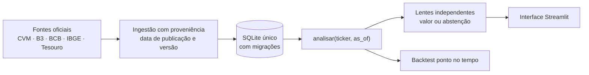

# Sentinela B3

[](https://github.com/Marcos-Felipe-dos-Santos/Sentinela-B3/actions/workflows/ci.yml)


Plataforma local para estudar **ações e FIIs da B3** com **dados oficiais**, métodos de valuation documentados e análise **em datas passadas**, com corte pelas informações disponíveis na data.

> **Projeto educacional para estudo de ativos.**

## Em 30 segundos

- **Dados oficiais:** demonstrações e cadastro da **CVM**, cotações e proventos da **B3**, séries do **BCB**, **IBGE** e **Tesouro Direto**.
- **Seis lentes de valuation separadas.** Cada uma mostra o valor, as premissas e a distância ao preço, ou diz por que se absteve. As lentes são exibidas individualmente, sem pontuação agregada.
- **Ponto no tempo:** `analisar(ticker, as_of)` responde com o que se sabia naquela data, pela data de publicação de cada documento.
- **Backtest ponto no tempo** com retorno total e um universo que inclui empresas deslistadas.
- **Mais de 5.000 testes**, regressões registradas, golden de comportamento e teste de mutação.

## O que ele calcula

| Lente | Ideia | Insumos principais |
|---|---|---|
| **Graham** | √(22,5 × LPA médio × VPA) | Cinco exercícios contíguos da CVM, LPA corrigido pelo IPCA |
| **Bazin** | Proventos de 12 meses ÷ 6% | Proventos brutos da B3. Perfil de renda, com DY bruto confiável de pelo menos 5% |
| **Lynch** | LPA × crescimento em pontos percentuais | Crescimento anual composto do LPA em quatro intervalos entre cinco exercícios, com teto de 25% |
| **Gordon** | Dividendo descontado a taxa real | Proventos dos controladores na DVA, custo de capital pela taxa real da cesta de NTN-B mais 5 pontos percentuais e crescimento real limitado pela projeção do PIB real |
| **FII (tijolo)** | Rendimento ÷ taxa exigida | Rendimentos do Informe Mensal da CVM e taxa real da NTN-B mais o spread calibrado e fixado na ficha |
| **Bancos** | P/VP justificado | ROE real, crescimento e custo de capital reais, VPA da CVM |

Além das lentes:

- **Qualidade:** quadro descritivo de cinco exercícios (ROE, lucro, margem, alavancagem, proventos), sem nota única.
- **Liquidez:** presença e volume nos últimos 63 pregões, pelo COTAHIST.
- **Contexto técnico:** RSI, MACD, Bollinger e médias móveis, que nunca entram no valor.
- **Explicação por IA, opcional:** Groq, Gemini ou Ollama local.

Cada lente tem uma [ficha metodológica](docs/metodologia/README.md) com fórmula, insumos, hipóteses, exemplo calculado à mão e sensibilidade.

## Decisões de projeto

- **Abstenção explícita.** Quando falta um insumo, a lente mostra o motivo da abstenção.
- **Taxa real nas lentes de desconto.** O desconto usa a taxa real da cesta de NTN-B, e o crescimento fica no mesmo regime.
- **Corte histórico pela disponibilidade.** A data de publicação orienta o corte quando está demonstrada. O resumo da Fase 3 documenta as fontes cobertas e os casos em que a falta de números da versão vigente ainda pode levar ao uso de um período anterior.
- **Métodos isolados.** As fórmulas trabalham com os insumos recebidos. Testes verificam o isolamento de rede, banco, relógio e leitura de arquivos.

## Como funciona



Na análise de hoje, o preço prioriza o último fechamento disponível no histórico do yfinance. Se ele faltar, usa a cotação informada pelo yfinance ou, na falta de preço válido, pela brapi. Na análise histórica, o fechamento vem do COTAHIST armazenado no banco local.

A cobertura histórica ainda é parcial. Na sonda da Fase 3, Graham e Lynch só tiveram valor nas observações de 2025 e a lente de rendimento do FII ficou sem valor em todo o recorte. O bloco 1 da Fase 4 amplia os dados históricos. O [resumo da Fase 3](docs/loop/historico/fase-3/pr-fase-3.md) traz os números de cobertura e as limitações.

## Status

**V2 em desenvolvimento ativo.** A Fase 3 foi concluída em 20/11/2026 (tag `v2-fase-3`). A Fase 4 está em andamento.

| Fase | Entrega | Resumo |
|---|---|---|
| 1 · Fundação | Tipos de unidade, contrato dos métodos e golden de extração | [Fase 1](docs/loop/historico/fase-1/pr-fase-1.md) |
| 2A · Dados corretos | Índice oficial de tickers, demonstrações da CVM, cinco exercícios, TTM e liquidez | [Fase 2A](docs/loop/historico/fase-2a/pr-fase-2a.md) |
| 2B · Taxa e escopo | Taxa real, lentes de Gordon, Bazin, FII e bancos, regras de escopo | [Fase 2B](docs/loop/historico/fase-2b/pr-fase-2b.md) |
| 2C · Qualidade e apresentação | Graham e Lynch revistos, lentes separadas, quadro de qualidade | [Fase 2C](docs/loop/historico/fase-2c/pr-fase-2c.md) |
| 3 · Tempo como entrada | Análise ponto no tempo, banco único, universo com deslistadas e backtest | [Fase 3](docs/loop/historico/fase-3/pr-fase-3.md) |

Os próximos passos incluem as correções da análise atual, a ampliação dos dados históricos no bloco 1 da Fase 4 e um modo offline. O plano também prevê operação diária pela linha de comando com rastreabilidade e backup, estudo de eventos com fatos relevantes da CVM, uma interface em FastAPI + HTMX e explicações por IA nas telas condicionadas ao resultado do estudo. O [plano da V2](docs/PLANO.md) traz critérios e dependências, e o resumo de cada fase lista as limitações conhecidas.

## Rodar localmente

Requer **Python 3.13**. No Linux ou no WSL2:

```bash
git clone https://github.com/Marcos-Felipe-dos-Santos/Sentinela-B3.git
cd Sentinela-B3
python3.13 -m venv venv
source venv/bin/activate
python -m pip install -r requirements.txt
streamlit run app.py
```

A interface abre em `http://localhost:8501`. O [`.env.example`](.env.example) lista as integrações opcionais. Configure só as que for usar e mantenha as chaves fora do Git.

## Qualidade e testes

```bash
python -m pip install -r requirements-dev.txt
python -m pytest tests/ --tb=short -rxX
ruff check --select E9,F63,F7,F82 .
```

- A suíte tem **mais de 5.000 testes**. As falhas esperadas documentam limitações conhecidas.
- **Regressões:** todo bug confirmado vira um teste que falha antes da correção e passa depois ([registro](tests/regressao/README.md)).
- **Golden:** um conjunto protegido de casos detecta mudança acidental de comportamento.
- **Mutação:** pelo menos 80% nos módulos de cálculo tocados.
- Nos testes Python, a suíte intercepta `socket.connect` e falha em tentativas de conexão que não usam sockets Unix locais.
- **[CI](.github/workflows/ci.yml)** com pytest e Ruff a cada push.

## Como é desenvolvido

Claude Code e Codex executam o trabalho com regras explícitas.

- A fila tem critérios de aceite verificáveis, um commit por item e diário de execução.
- O diff passa por revisão antes de cada commit.
- Claude, Codex e Gemini participam da auditoria cruzada. O auditor pertence a uma família diferente da do executor.
- A ficha metodológica precisa de aprovação antes da implementação da fórmula.

O processo está documentado em [`docs/loop/`](docs/loop/), e as decisões de arquitetura em [`docs/adr/`](docs/adr/).

---

Desenvolvido por **Marcos Felipe dos Santos**.
